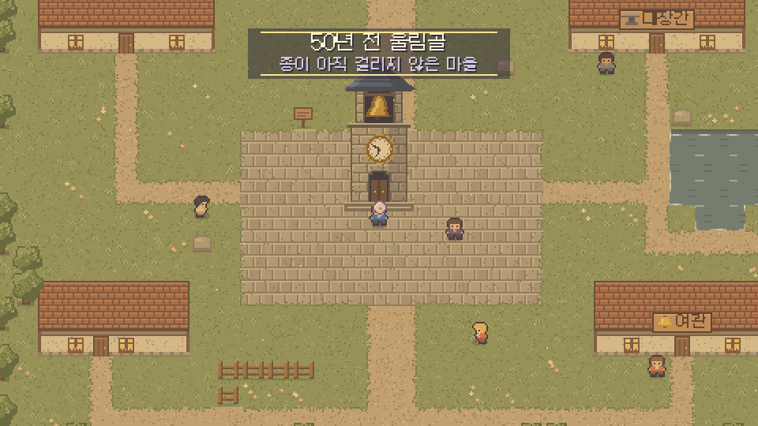

# Hourbell

> 세계의 시간을 알리던 종이 멈췄다. 종소리는 선율이 되어 여러 시대로 흩어졌다.

**바로 플레이: https://hourbell.vercel.app** (PC 브라우저, 휴대폰, 태블릿)



**Hourbell**은 16비트 시절 JRPG의 정신을 잇는 브라우저 RPG입니다.
기억나는 장면보다 **음악과 그림**이 오래 남았던 그 시절 게임들처럼, 시스템보다 분위기가 주인공인 게임을 목표로 합니다.

## 핵심 방향

| 기둥 | 내용 |
|---|---|
| 멜로디 중심 음악 | 지역마다 흥얼거릴 수 있는 주제 선율 1개. 같은 선율을 마을, 필드, 전투, 엔딩에서 편곡만 바꿔 재사용 |
| 장인급 도트 | 낮은 해상도, 풍부한 색과 애니메이션. 물결, 나뭇잎, 빛처럼 살아 있는 배경 |
| 연출로 감정 전달 | 대사보다 음악 전환, 색, 카메라로 장면을 만듦 |
| 가벼운 시스템 | 누구나 끝까지 갈 수 있는 단순한 전투와 메뉴 |

## 이야기 뼈대

시간을 알리던 대종 **아워벨**이 멈춘 뒤, 세계는 같은 하루를 맴돌기 시작합니다.
주인공은 각 시대에 흩어진 종소리 조각을 되찾습니다. 조각을 하나 찾을 때마다 그 지역의 음악이 한 소절씩 완성되고, 멈춰 있던 풍경이 다시 움직입니다.

## 현재 단계

**v1.1** - 바람결 들판부터 아워벨 내부까지 일곱 장, 엔딩과 크레딧까지 플레이 가능 (장마다 약 20~30분). 바뀐 점은 [CHANGELOG.md](CHANGELOG.md)에 있습니다.

- 성장: 레벨업 시 HP, 울림, 공격, 방어, 속도 상승. Lv 3에 바람결, Lv 5에 맑은울림, 그 뒤 장마다 하나씩(Lv 6 물안개 노래, 9 메아리치기, 12 태엽 감기, 15 서리 방패, 18 별바람, 21 아워벨). 보스는 Lv 4 전후를 요구
- 전투: 공격, 기술, 도구, 방어, 도망. 속도 순서로 행동하고, 소리와 바람 속성에 약점과 내성이 있음. 적은 계열마다 고유 행동(울림 삼키기, 웅크리기, 연속 공격, 회복, 도망, 빛 터뜨리기)
- 보스: 고요의 파동, 공격을 반감하는 안개, 기술을 막는 침묵 (맑은물로 해제). 큰 기술은 행동을 고르기 전에 예고
- 장 구성 (권장 레벨은 그 장의 장비를 갖춘 보스 기준)
  1. 바람결 들판 (Lv 4) - 침묵의 파수꾼
  2. 물안개 항구 (Lv 6) - 안개삼킴이, 그물 영감의 진주
  3. 메아리 협곡 (Lv 9) - 마을 북쪽, 울림 광산의 메아리왕. 단비 합류
  4. 50년 전 울림골 (Lv 12) - 시계탑으로 과거로, 째깍 숲의 시간갉기. 하루 합류
  5. 눈꽃 산마루 (Lv 15) - 협곡 북쪽, 서리날개와 눈보라
  6. 별빛 천문대 (Lv 18) - 산마루 너머 구름다리, 일식
  7. 아워벨 내부 (Lv 21) - 시계탑으로 종 안에, 최종 보스 정적. 엔딩과 크레딧
- 장마다 새 장비 7칸 세트, 여관과 상점, 서브 퀘스트 하나
- 이야기: 메인 퀘스트와 서브 퀘스트 2개, 메뉴의 일지. 여관의 노래꾼 미오가 동료로 합류해 전투에서 노래로 돕는다
- 탐험: 들어갈 수 있는 여관, 숨은 길 너머의 비밀 숲, 보물 상자, 풍경 퍼즐. 2~7장 길마다 숨은 구석(뚜껑의 힌트대로 풍경을 울리면 열리는 상자와 숨은 장비)
- 파티: 영웅 + 동료 최대 3명(회복, 전사, 술사). 동료마다 장신구 한 칸. 펫 방울은 전투 뒤 물건을 물어 오고 걷는 동안 HP를 채움
- 자동: 전투의 자동 버튼, 필드 자동 사냥(Q 또는 메뉴). HP가 낮거나 적이 없으면 이유를 알리고 멈춤
- 장비: 무기, 머리, 몸, 손, 발, 장신구, 악보(기술 위력) 7칸. 대장간에서 사고 팔 수 있음 (메뉴의 장비에서 착용)
- 경제: 골드와 드롭, 꽃집(약초, 울림방울, 맑은물), 판매는 반값. 쓰러지면 골드 절반을 잃음
- 옵션: 쉬움(적에게 받는 피해 3/4), 음악, 효과음 볼륨, 글자 속도, 화면 흔들림과 섬광 끄기. 창을 벗어나면 자동 일시정지
- 길 찾기: 조각을 얻으면 종소리를 따라 울림골로 돌아갈 수 있음. 메뉴의 지도에 가 본 곳, 현재 위치, 다음 목표
- 기록: 메뉴에서 기록, 여관과 보스 승리·조각 획득 뒤 자동 기록, 타이틀에서 이어하기. 메뉴 > 세이브 코드로 다른 기기에 옮기기
- 쓰러지면 그 장에서 마지막으로 쉰 여관에서 깨어남

개선 점검표는 [docs/CHECKLIST.md](docs/CHECKLIST.md)(200항목, 진행 중)와 [docs/AUDIT-500.md](docs/AUDIT-500.md)에 있습니다.

버그나 의견은 [GitHub Issues](https://github.com/inviy/Hourbell/issues)에 남겨 주세요. 게임 안에서는 메뉴 > 옵션 > 의견 보내기로 열 수 있습니다.

## 실행

빌드 과정은 없습니다. 글꼴 로딩 때문에 로컬 서버로 여는 것을 권장합니다.

```bash
python3 -m http.server 8000   # 또는 npx serve .
# http://localhost:8000 접속
```

| 조작 | 키 |
|---|---|
| 이동 | 방향키 또는 WASD |
| 조사, 대화, 결정 | Z, Enter, Space |
| 취소, 메뉴 열기 | X, Esc |
| 자동 사냥 켜기, 끄기 | Q |
| 소리 켜기, 끄기 | M |

휴대폰과 태블릿에서는 방향 패드와 A, B 버튼이 가로 화면에서는 양옆, 세로 화면에서는 아래에 나타납니다.

## 원칙

- 그래픽과 음악은 모두 **오리지널**로 만듭니다. 기존 게임의 캐릭터, 곡, 디자인은 사용하지 않습니다.
- 외부 에셋은 무료(CC0 등) 라이선스만 사용하고 출처를 `docs/CREDITS.md`에 기록합니다.

규칙, 밸런스, 맵 데이터 테스트 (Node 18 이상):

```bash
node --test tests/*.test.mjs   # 규칙, 밸런스, 맵 데이터 (CI에서도 실행)
node tests/smoke.mjs           # 헤드리스 Chrome으로 처음부터 엔딩까지 (Chrome 필요, CHROME=경로로 지정 가능)
node tests/real.mjs 2 8 mash   # 실제 게임으로 보스전을 치러 시뮬레이션 승률과 비교 (장, 레벨, auto|mash, 횟수)
node tests/layout.mjs          # 휴대폰 세로·가로, 태블릿, PC 1080p·4K에서 화면 배치와 배율 확인
python tools/subset-fonts.py   # 새 대사를 넣은 뒤 글꼴 서브셋 다시 만들기 (fonttools, brotli 필요)
```

전투 난수는 `HB.rand`를 거치므로 `HB.seedRandom(숫자)`로 같은 전투를 그대로 다시 볼 수 있습니다.

자세한 기획은 [docs/DESIGN.md](docs/DESIGN.md)를 참고하세요.
